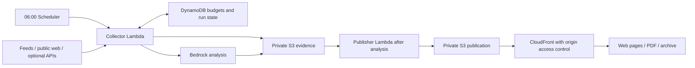

# Signal & Sound — AI newspaper

A small, self-hosted AI newspaper designed to be read, printed, and put down. Two sections—General AI and AI for Music—become responsive web pages and one two-page A4 PDF. Python, static HTML/CSS, and a compact AWS serverless pipeline.

## What it does

- Six source-linked stories per page, roughly 60% broad news and 40% interest-related coverage.
- Clear publication dates and New/Revisited/Learning labels; reported findings separated from implications.
- Concept explanations with practical “why it matters” notes.
- A printable two-page edition with editor notes and estimated reading time.
- Mobile-friendly PDF download plus an inline PDF for the browser's share/print flow.
- Daily analysis followed by rendering; a separate Monday digest for the completed week.
- Versioned editions, an archive, private evidence storage, bounded interest updates and application cost reservations.

## Run locally

Python 3.12+ and [uv](https://docs.astral.sh/uv/) are required.

```sh
uv sync --frozen
.venv/bin/python -m scripts.seed_preview
.venv/bin/python -m newspaper run --edition private/today.json
.venv/bin/python -m newspaper serve --port 8787
```

Open http://localhost:8787. The example is an October 21, 2026 edition with real, dated source links. It is a reproducible sample, not an assertion that those items are today's news whenever you install this project. Only dist/ is served, on loopback.

Edit the ignored config/interests.json to personalize topic weights. The public example contains generic technical and music interests. To edit a published edition, increment its revision before rendering. Old revision URLs remain immutable.

## Analyze fresh sources

```sh
.venv/bin/python -m newspaper collect
.venv/bin/python -m newspaper run --kind daily
.venv/bin/python -m newspaper run --kind weekly
.venv/bin/python -m newspaper status
```

Feeds and direct public sources work without search credentials. Optional BRAVE_API_KEY and X_BEARER_TOKEN add discovery. Automated writing uses Amazon Bedrock and requires an authorized AWS identity. Never commit tokens. Deployed tokens are read from encrypted SSM parameters; the reusable source does not contain credentials.

The analysis extracts evidence, composes an edition and performs an automated evidence review. Validators check citations, dates, editorial balance and print constraints. Failed analysis or rendering keeps the previous issue live. Automated evidence review reduces errors but does not guarantee factual accuracy.

## Architecture



The collector invokes the publisher only after saving a validated edition. HTML and PDF use the same structured story data. Latest pointers update after artifacts are complete. Static files need no application server, cookies, analytics or user account.

AWS deployment is documented in [infra/DEPLOYMENT.md](infra/DEPLOYMENT.md). The template defaults to disabled delivery and scheduling for a deliberate launch. It includes a Free-tier CloudFront pricing subscription and its required WAF association. Verify eligibility and current prices before launch. The host's first reporting week begins Wednesday, October 21; subsequent weeks run Monday–Sunday. Change started_at and timezone for your own installation.

## Interest updates

Explicit preferences stay authoritative. Work-derived updates are limited to .05 per topic per week and carry dated evidence. Automated reminder repetitions are ignored; silence is not disinterest. Prior versions are retained for reversal. An optional local Codex automation can read human-authored work and submit observations; the AWS pipeline receives only sanitized topics, never raw chats or personal biographies.

```sh
.venv/bin/python -m newspaper interests private/observations.json
```

Observation shape:

```json
[{"topic":"voice","source":"local note or chat reference","date":"2026-10-21","kind":"work","reason":"A human request explores voice interaction"}]
```

## X ranking

A bounded daily sample uses topical relevance (35%), linked evidence (25%), URL novelty (15%), curated author credibility (10%), freshness (10%) and age-normalized engagement (5%). The minimum score is 65/100. Reposts and replies are excluded; links are required. Popularity alone cannot pass. URL novelty is a lightweight proxy; editorial review still needs to merge reports of the same event. The default cap is ten posts daily. Unconnected sources are disclosed in the edition.

## Costs and reliability

Default target: $5/month; estimated application stop: $8, including a $1 infrastructure reserve. Bedrock and X also have individual caps. Reservations are atomic and ambiguous charges are retained rather than blindly retried. This is not a hard AWS invoice cap. Search assumes a free-credit account with paid replenishment disabled. Current provider prices, account eligibility and real usage must be checked independently.

## Development

```sh
.venv/bin/python -m pytest -q
sam validate --lint --template-file infra/template.yaml
sam build --template-file infra/template.yaml --use-container
```

Tests cover dates, inaugural weekly coverage, budgets, idempotency, evidence schemas, source URL boundaries, public redaction, PDF page count and immutable revisions. Browser and print layout checks remain part of release QA. Paid-provider calls are mocked in unit tests.

Released under the MIT license. Linked articles and source material retain their respective rights; the software license does not relicense them.
